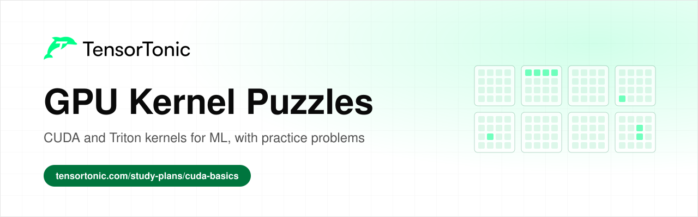
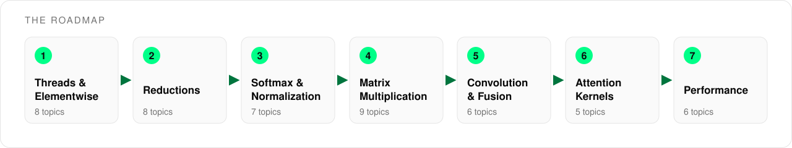

# GPU Kernel Puzzles

  

This is a roadmap of GPU kernel puzzles built from the operations that machine learning models are made of. It covers 49 topics across seven stages, from a first vector addition to FlashAttention and kernel performance.

Every topic links to an explanation where one exists and to practice problems where you write the kernel in CUDA or Triton and check it against tests. The puzzles start small and get harder stage by stage, and together they cover the patterns that real ML kernels reuse.

## Table of Contents

- [Who this is for](#who-this-is-for)
- [How to use this roadmap](#how-to-use-this-roadmap)
- [Stage 1: Threads and Elementwise Kernels](#stage-1-threads-and-elementwise-kernels)
- [Stage 2: Reductions](#stage-2-reductions)
- [Stage 3: Softmax and Normalization](#stage-3-softmax-and-normalization)
- [Stage 4: Matrix Multiplication](#stage-4-matrix-multiplication)
- [Stage 5: Convolution and Fusion](#stage-5-convolution-and-fusion)
- [Stage 6: Attention Kernels](#stage-6-attention-kernels)
- [Stage 7: Performance](#stage-7-performance)
- [What's next](#whats-next)

## Who this is for

This roadmap is for anyone who uses PyTorch and wants to know what happens on the GPU when a layer runs.

- If you are a **student**, go through the stages in order and solve at least one puzzle per topic.
- If you are **preparing for interviews**, the reductions, softmax, matrix multiplication and performance stages cover most of the kernel questions that come up.
- If you already **work in ML**, use the tables as a checklist and start with the kernels you have only ever called from a library.

You need Python and a little C. You do not need your own GPU, because the practice problems run your kernel on GPU hardware and compare it against a reference.

## How to use this roadmap

Each stage builds on the ones before it. Reductions reuse the indexing from the first stage, softmax and normalization are built from reductions, and attention combines tiled matrix multiplication with an online softmax.

For each topic, read the explanation first, then solve one or two of the puzzles. Most topics have a CUDA and a Triton version, and writing both is a good way to see what Triton handles for you. Topics without a read link are covered well enough by the problem statement itself.

## Stage 1: Threads and Elementwise Kernels

Every kernel starts by working out which element each thread owns. This stage covers thread and block indexing, bounds checks and 2D grids, then applies them to the activation functions and dropout that run after nearly every layer.

| Topic | Read | Practice |
| --- | --- | --- |
| Thread and block indexing | [How to Learn CUDA: From C to Fused Kernels](https://www.tensortonic.com/guides/how-to-learn-cuda) | [Vector Addition as a CUDA Kernel](https://www.tensortonic.com/problems/vector-addition), [Vector Addition in Triton](https://www.tensortonic.com/problems/triton-vector-addition) |
| Bounds checks and masks | [CUDA Practice Problems: A Learning Path](https://www.tensortonic.com/guides/cuda-practice-problems) | [Vector Subtraction as a CUDA Kernel](https://www.tensortonic.com/problems/vector-subtract), [Masked Triton GELU Kernel](https://www.tensortonic.com/problems/cs336-l06-triton-masked-gelu) |
| 2D grids | | [Matrix Addition as a CUDA Kernel](https://www.tensortonic.com/problems/matrix-addition), [Hadamard Product as a CUDA Kernel](https://www.tensortonic.com/problems/hadamard-product) |
| ReLU and Leaky ReLU | | [ReLU as a CUDA Kernel](https://www.tensortonic.com/problems/relu), [ReLU in Triton](https://www.tensortonic.com/problems/triton-relu) |
| Sigmoid and tanh | | [Sigmoid as a CUDA Kernel](https://www.tensortonic.com/problems/sigmoid), [Tanh as a CUDA Kernel](https://www.tensortonic.com/problems/tanh) |
| GELU | | [Exact GELU as a CUDA Kernel](https://www.tensortonic.com/problems/cuda-gelu), [GELU in Triton](https://www.tensortonic.com/problems/triton-gelu) |
| SiLU | | [Swish (SiLU) as a CUDA Kernel](https://www.tensortonic.com/problems/swish), [SiLU in Triton](https://www.tensortonic.com/problems/triton-silu) |
| Dropout | | [Dropout as a CUDA Kernel](https://www.tensortonic.com/problems/dropout), [Dropout (Inverted Scaling) in Triton](https://www.tensortonic.com/problems/triton-dropout) |

## Stage 2: Reductions

A reduction turns many values into one, so threads have to cooperate instead of working alone. This stage starts with a parallel sum and builds up to multi-block reductions, norms and statistics that later kernels depend on.

| Topic | Read | Practice |
| --- | --- | --- |
| Parallel sum | [CUDA Interview Questions for ML Engineers](https://www.tensortonic.com/guides/cuda-interview-questions) | [Sum of Array as a CUDA Kernel](https://www.tensortonic.com/problems/sum-of-array), [Vector Sum Reduction in Triton](https://www.tensortonic.com/problems/triton-sum) |
| Max and min | | [Max of Array as a CUDA Kernel](https://www.tensortonic.com/problems/max-of-array), [Vector Max Reduction in Triton](https://www.tensortonic.com/problems/triton-max) |
| Argmax and argmin | | [Argmax as a CUDA Kernel](https://www.tensortonic.com/problems/argmax), [Argmin as a CUDA Kernel](https://www.tensortonic.com/problems/argmin) |
| Multi-block dot product | [Dot Product and Vector Norms: L1, L2 and Cosine](https://www.tensortonic.com/ml-math/linear-algebra/dot-norm) | [CUDA Dot Product: Multi-Block Reduction](https://www.tensortonic.com/problems/cuda-dot-product) |
| Vector norms | [Dot Product and Vector Norms: L1, L2 and Cosine](https://www.tensortonic.com/ml-math/linear-algebra/dot-norm) | [L2 Vector Norm in Triton](https://www.tensortonic.com/problems/triton-l2-norm), [L2 Normalization as a CUDA Kernel](https://www.tensortonic.com/problems/l2-normalize) |
| L1 normalization | | [L1 Normalization as a CUDA Kernel](https://www.tensortonic.com/problems/l1-normalize) |
| Cosine similarity | [Dot Product and Vector Norms: L1, L2 and Cosine](https://www.tensortonic.com/ml-math/linear-algebra/dot-norm) | [Cosine Similarity as a CUDA Kernel](https://www.tensortonic.com/problems/cuda-cosine-similarity) |
| Mean and variance | | [Mean and Variance as a CUDA Kernel](https://www.tensortonic.com/problems/mean-variance), [Single-Pass Mean and Variance in Triton](https://www.tensortonic.com/problems/triton-mean-variance) |

## Stage 3: Softmax and Normalization

Softmax and normalization layers run one reduction per row and then rescale that row. Getting them right means handling numerical stability, and getting them fast means reading each row from memory as few times as possible.

| Topic | Read | Practice |
| --- | --- | --- |
| Stable softmax | | [Softmax as a CUDA Kernel](https://www.tensortonic.com/problems/softmax), [Fused Row-Wise Softmax in Triton](https://www.tensortonic.com/problems/triton-fused-softmax) |
| Row-wise LogSumExp | | [Row-Wise LogSumExp in Triton](https://www.tensortonic.com/problems/triton-logsumexp), [Tiled Triton Row Sum](https://www.tensortonic.com/problems/cs336-l06-triton-tiled-row-sum) |
| Online softmax | [FlashAttention Explained: Tiling and Memory](https://www.tensortonic.com/llm-internals/flash-attention) | [Online Softmax Kernel in Triton](https://www.tensortonic.com/problems/triton-online-softmax) |
| Cross-entropy loss | [Cross-Entropy Loss: Formula and BCE vs MSE](https://www.tensortonic.com/ml-math/information-theory/cross-entropy) | [Cross-Entropy Loss as a CUDA Kernel](https://www.tensortonic.com/problems/cross-entropy), [Cross Entropy Loss (Mean Reduction) in Triton](https://www.tensortonic.com/problems/triton-cross-entropy) |
| Layer normalization | | [Layer Normalization as a CUDA Kernel](https://www.tensortonic.com/problems/layer-norm), [LayerNorm Forward in Triton](https://www.tensortonic.com/problems/triton-layernorm) |
| RMS normalization | | [RMS Normalization as a CUDA Kernel](https://www.tensortonic.com/problems/rms-norm), [RMSNorm Forward in Triton](https://www.tensortonic.com/problems/triton-rmsnorm) |
| LayerNorm backward | | [LayerNorm Backward in Triton](https://www.tensortonic.com/problems/triton-layernorm-backward) |

## Stage 4: Matrix Multiplication

Matrix multiplication is where most of the compute in a neural network goes. This stage moves from transposes and matrix-vector products to a naive matmul, then to shared-memory tiling and the launch tricks used in production Triton kernels.

| Topic | Read | Practice |
| --- | --- | --- |
| Matrix transpose | | [Matrix Transpose as a CUDA Kernel](https://www.tensortonic.com/problems/cuda-matrix-transpose), [Tiled Transpose in Triton](https://www.tensortonic.com/problems/triton-transpose) |
| Outer product | [Matrix Multiplication for Deep Learning](https://www.tensortonic.com/ml-math/linear-algebra/matrix-multiplication) | [Outer Product as a CUDA Kernel](https://www.tensortonic.com/problems/outer-product) |
| Matrix-vector product | | [Matrix-Vector Multiplication as a CUDA Kernel](https://www.tensortonic.com/problems/gemv), [GEMV: Matrix Vector Product in Triton](https://www.tensortonic.com/problems/triton-gemv) |
| Naive matrix multiplication | [Matrix Multiplication for Deep Learning](https://www.tensortonic.com/ml-math/linear-algebra/matrix-multiplication) | [Matrix Multiplication as a CUDA Kernel](https://www.tensortonic.com/problems/matrix-multiplication) |
| Shared-memory tiling | [How to Learn CUDA: From C to Fused Kernels](https://www.tensortonic.com/guides/how-to-learn-cuda) | [Tiled Matrix Multiplication as a CUDA Kernel](https://www.tensortonic.com/problems/tiled-matmul), [Tiled Matrix Multiplication in Triton](https://www.tensortonic.com/problems/triton-matmul) |
| Block pointers | | [Block-Pointer Matmul in Triton](https://www.tensortonic.com/problems/triton-block-pointer-matmul) |
| Grouped launch order | | [Grouped Program-ID Matmul in Triton](https://www.tensortonic.com/problems/triton-grouped-matmul) |
| Split-K | | [Split-K Matmul in Triton](https://www.tensortonic.com/problems/triton-split-k-matmul) |
| Autotuning | | [Autotuned Matrix Multiplication in Triton](https://www.tensortonic.com/problems/triton-matmul-autotune) |

## Stage 5: Convolution and Fusion

Convolutions slide a small filter over an input, which makes them a good exercise in reusing neighbouring data. Fusion combines several operations into one kernel so that intermediate results never go back to global memory.

| Topic | Read | Practice |
| --- | --- | --- |
| 1D convolution | | [1D Convolution as a CUDA Kernel](https://www.tensortonic.com/problems/conv-1d) |
| 2D convolution | | [2D Convolution as a CUDA Kernel](https://www.tensortonic.com/problems/conv-2d) |
| 3D convolution | | [3D Convolution as a CUDA Kernel](https://www.tensortonic.com/problems/conv-3d) |
| Max pooling | | [Max Pool 2D as a CUDA Kernel](https://www.tensortonic.com/problems/max-pool-2d) |
| Fused multiply-add | [How to Learn CUDA: From C to Fused Kernels](https://www.tensortonic.com/guides/how-to-learn-cuda) | [Fused Multiply-Add in Triton](https://www.tensortonic.com/problems/triton-fused-multiply-add) |
| Fused matmul, bias and ReLU | | [Fused Matmul + Bias + ReLU in Triton](https://www.tensortonic.com/problems/triton-fused-matmul-bias-relu), [Fused Tiled Matmul and ReLU](https://www.tensortonic.com/problems/cs336-l06-triton-matmul-relu) |

## Stage 6: Attention Kernels

Attention is the kernel that matters most for transformers, and it reuses almost everything from the earlier stages. This stage covers plain scaled dot-product attention, rotary embeddings and the KV cache, then the blockwise softmax that lets FlashAttention avoid storing the full score matrix.

| Topic | Read | Practice |
| --- | --- | --- |
| Scaled dot-product attention | [Attention in LLMs: Queries, Keys and Values Explained](https://www.tensortonic.com/llm-internals/attention-mechanism) | [Scaled Dot-Product Attention in CUDA](https://www.tensortonic.com/problems/scaled-dot-product-attention), [Scaled Dot-Product Attention in Triton](https://www.tensortonic.com/problems/triton-scaled-dot-product-attention) |
| Rotary position embedding | [RoPE: Rotary Position Embedding Explained](https://www.tensortonic.com/llm-internals/rope) | [Rotary Position Embedding in Triton](https://www.tensortonic.com/problems/triton-rope) |
| KV cache append | [KV Cache in LLMs: How It Makes Inference Fast](https://www.tensortonic.com/llm-internals/kv-cache) | [KV Cache Append in Triton](https://www.tensortonic.com/problems/triton-kv-append) |
| Blockwise online softmax | [FlashAttention Explained: Tiling and Memory](https://www.tensortonic.com/llm-internals/flash-attention) | [Blockwise Online Softmax](https://www.tensortonic.com/problems/cs336-l05-blockwise-online-softmax) |
| FlashAttention forward | [Write FlashAttention Step by Step](https://www.tensortonic.com/projects/flash-attention-from-scratch) | [FlashAttention Forward Kernel in Triton](https://www.tensortonic.com/problems/triton-flash-attention-fwd) |

## Stage 7: Performance

A kernel that passes its tests can still be slow. This stage covers the memory access patterns, occupancy limits and measurements that explain why one correct kernel runs many times faster than another.

| Topic | Read | Practice |
| --- | --- | --- |
| Global memory coalescing | [How to Learn CUDA: From C to Fused Kernels](https://www.tensortonic.com/guides/how-to-learn-cuda) | [Global-Memory Coalescing Counter](https://www.tensortonic.com/problems/cs336-l05-global-memory-coalescing) |
| Shared memory bank conflicts | [CUDA Interview Questions for ML Engineers](https://www.tensortonic.com/guides/cuda-interview-questions) | [Shared-Memory Bank Conflict Analyzer](https://www.tensortonic.com/problems/cs336-l05-shared-memory-bank-conflicts) |
| Occupancy | [CUDA Interview Questions for ML Engineers](https://www.tensortonic.com/guides/cuda-interview-questions) | [GPU Occupancy Calculator](https://www.tensortonic.com/problems/cs336-l05-gpu-occupancy-calculator) |
| Vectorized loads | | [Vectorized Vector Add in Triton](https://www.tensortonic.com/problems/triton-vectorized-load) |
| Kernel timeline utilization | | [Measure Kernel Timeline Utilization](https://www.tensortonic.com/problems/cs336-l18-kernel-timeline-utilization) |
| Benchmarking a kernel | [CUDA Practice Problems: A Learning Path](https://www.tensortonic.com/guides/cuda-practice-problems) | |

## What's next

Once these puzzles feel familiar, the [CUDA Kernels](https://www.tensortonic.com/study-plans/cuda-basics) and [Triton Kernels](https://www.tensortonic.com/study-plans/triton-basics) study plans put the same problems in a set order. The [Inference Engineering](https://www.tensortonic.com/guides/inference-engineering) guide shows where these kernels fit in serving large language models, and the [ML Systems and GPU Programming](https://www.tensortonic.com/projects/sheets/ml-systems-gpu-programming) projects take them into full builds.

If you enjoyed the Triton versions of these puzzles most, the [How to Learn Triton](https://www.tensortonic.com/guides/how-to-learn-triton) guide explains how to keep learning Triton after the first few kernels.

## License

MIT
